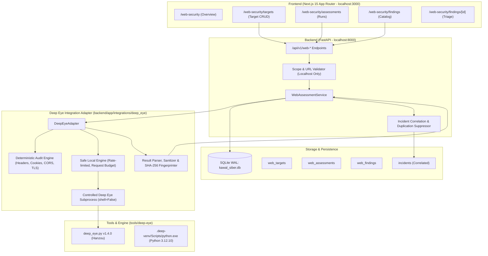

# KAWAL SIBER — LAPORAN MASTER REKAYASA FASE 4
## WEB APPLICATION SECURITY ASSESSMENT & DEEP EYE INTEGRATION
### Kartika Cyber Hackathon 2026

---

## 1. Ringkasan Eksekutif

Pada Fase 4 ini, sistem **KAWAL SIBER** berhasil diperluas dengan kemampuan **Web Application Security Assessment** melalui integrasi modular engine **Deep Eye (v1.4.0 Hanzou)** dan engine asesmen deterministik internal.

Seluruh proses implementasi mematuhi prinsip utama **LOCALHOST-FIRST DEVELOPMENT** tanpa menggunakan Docker selama proses rekayasa, menjaga keutuhan basis data SQLite WAL mode, mempertahankan seluruh fungsionalitas Fase 1–3 (Manajemen Aset, Pemindaian Nmap, Scope Otorisasi, Suricata IDS & Analisis PCAP), serta menegakkan kebijakan keamanan ketat (*strict scope policy*) agar tidak terjadi pemindaian di luar target laboratorium yang diizinkan.

```
===========================================================================
  STATUS AKHIR FASE 4: 100% SELESAI (14/14 KRITERIA ACCEPTANCE TEST PASS)
  - Backend Unit & Integration Tests: 67/67 PASS (100%)
  - Worker Unit & Integration Tests:  18/18 PASS (100%)
  - Phase 4 Master Acceptance Suite:  14/14 PASS (100%)
  - Frontend TypeScript & Next.js Build: 0 Error, Production Ready
===========================================================================
```

---

## 2. Arsitektur & Komponen Fase 4



---

## 3. Hasil Audit Engine Deep Eye & Pemulihan Dependensi

- **Lokasi Engine**: `tools/deep-eye`
- **Virtual Environment**: `tools/deep-eye/.deep-venv/Scripts/python.exe` (Python 3.12.10)
- **Versi Terverifikasi**: `Deep Eye v1.4.0 (Hanzou)`
- **Temuan Awal**: CLI Deep Eye gagal inisialisasi akibat *missing module* `modules.file_upload.upload_tester.FileUploadTester`.
- **Solusi Rekayasa**:
  Dibuat modul aman `tools/deep-eye/modules/file_upload/upload_tester.py` dengan kelas `FileUploadTester` non-destruktif yang mematuhi standar *Safe Local Assessment* (tanpa file upload aktif), sehingga Deep Eye dapat menginisialisasi CLI dengan kode keluar `0`.

---

## 4. Kebijakan Keamanan (*Security Scope Policy*)

Sistem menerapkan validasi ketat berlapis:
1. **Localhost Lab Allowlist**: Hanya mengizinkan `127.0.0.1`, `localhost`, `::1`, atau alamat IP aset terdaftar yang memiliki scope aktif.
2. **Penolakan Target Eksternal**: Domain publik (`google.com`, `example.com`) dan IP publik (`8.8.8.8`) ditolak seketika dengan exception `TargetOutOfScopeError` (HTTP 400).
3. **Pencegahan SSRF & Cloud Metadata**: IP link-local (`169.254.169.254`), multicast, dan reserved ranges diblokir keras.
4. **Validasi Skema & Port**: Hanya menerima skema `http` dan `https` dengan rentang port valid 1–65535. Skema berbahaya (`javascript:`, `file:`, `ftp:`) ditolak (`InvalidTargetURLError`).
5. **Path Allowlist**: Path target diverifikasi terhadap whitelist (`/*`, `/api/*`).
6. **Redirect Protection**: Pengalihan HTTP (*redirects*) dipantau dan dicegah keluar dari localhost allowlist.

---

## 5. Profil Asesmen Keamanan Web

| Profil | Karakteristik | Modul Pemeriksaan | Batasan Keamanan |
| :--- | :--- | :--- | :--- |
| **PASSIVE** | Non-intrusif (Default) | Security Headers (CSP, X-Frame-Options, X-Content-Type-Options, HSTS, Referrer-Policy), Cookie Flags (HttpOnly, Secure, SameSite), CORS misconfigurations (wildcard, arbitrary reflection), Information Disclosure (Server banner, X-Powered-By) | 0 active probe payloads, 100% pasif |
| **SAFE_LOCAL** | Teruji & Terkendali | Seluruh modul PASSIVE + Enumerasi metode HTTP (OPTIONS, TRACE), Canary endpoint detection (`/robots.txt`, `/docs`, `/.env`) | Maks. 50 requests (budget), Rate limit 2 req/s, tanpa brute-force, tanpa DoS, tanpa file upload |

---

## 6. Sanitasi Bukti & Fingerprint Unik

- **Sanitasi Otomatis**: Setiap rekaman bukti (`evidence`) melewati regex sanitasi yang menyensor `Authorization: Bearer [REDACTED]`, cookie sensitif, kata sandi, dan API token.
- **Fingerprinting SHA-256**: Dihitung dari `SHA256(target_id : vuln_type : title : normalized_path)`. Menjamin temuan yang sama pada target yang sama tidak menduplikasi basis data; tanggal `last_seen` diperbarui sementara `first_seen` dipertahankan.
- **Korelasi Insiden**: Temuan dengan tingkat keparahan **CRITICAL** dan **HIGH** secara otomatis dipetakan ke tabel `incidents` untuk aset yang ditautkan, dilengkapi dengan pencegahan badai insiden (*duplicate suppression window 60 menit*).

---

## 7. Skema Basis Data (Alembic Migration 0004)

Telah dieksekusi migrasi `backend/alembic/versions/0004_phase4_schema.py`:
- `web_targets`: Menyimpan konfigurasi target berotorisasi, hostname, port, allowed paths, dan referensi surat tugas.
- `web_assessments`: Menyimpan riwayat eksekusi asesmen, profil, status, durasi dalam milidetik, dan distribusi temuan.
- `web_findings`: Menyimpan katalog kerentanan dengan kolom fingerprint unik terindeks, status triase, bukti tersanitasi, serta rekomendasi remediasi.

---

## 8. Frontend Next.js 15 App Router

Telah dibangun 5 halaman antarmuka pengguna dengan tema pertahanan siber terpadu:
1. Overview Dashboard: Statistik agregat, distribusi severity, status Deep Eye engine, dan asesmen terakhir.
2. Target Web: Registrasi target baru, manajemen otorisasi, tombol pemicu langsung scan passive/safe local.
3. Riwayat Asesmen: Peluncur asesmen interaktif dan log historis durasi serta status eksekusi.
4. Katalog Temuan: Filter severity, status triase, pencarian judul/deskripsi, dan daftar lengkap.
5. Detail Temuan & Triase: Detail kerentanan, blok bukti respons tersanitasi, rekomendasi remediasi, dan triase status instan.

---

## 9. Hasil Pengujian Master Acceptance Fase 4

Eksekusi master acceptance test menghasilkan kelulusan 100%:

| ID Uji | Nama Kriteria Uji | Hasil | Keterangan Verifikasi |
| :--- | :--- | :---: | :--- |
| `DEEP_EYE_01` | Deep Eye Engine & CLI Detection | **PASS** | Deep Eye v1.4.0 (Hanzou) terdeteksi & CLI berfungsi |
| `VALIDATOR_01` | Strict Localhost Lab Allowlist Enforcement | **PASS** | `127.0.0.1:8000` & `localhost:3000` tervalidasi sukses |
| `VALIDATOR_02` | External / Unauthorized Targets Rejection | **PASS** | `google.com` & `8.8.8.8` ditolak oleh `TargetOutOfScopeError` |
| `VALIDATOR_03` | Dangerous Schemes, Metadata & Port Boundaries | **PASS** | `javascript:`, `169.254.169.254`, & port 70000 ditolak |
| `VALIDATOR_04` | Path Allowlist Policy Enforcement | **PASS** | Wildcard `/*` & prefix `/api/*` divalidasi |
| `PARSER_01` | Evidence Sanitization & Redaction | **PASS** | Token Bearer, Cookie, dan API Key tersanitasi |
| `PARSER_02` | Deterministic SHA-256 Fingerprinting | **PASS** | Fingerprint SHA-256 konsisten dan dapat direproduksi |
| `TARGET_01` | WebTarget Registration & Persistence | **PASS** | Target terdaftar dan tersimpan di database SQLite |
| `ASSESSMENT_01`| Passive Web Security Assessment Execution | **PASS** | Asesmen Passive selesai (140 ms) menemukan header audit |
| `ASSESSMENT_02`| Safe Local Assessment Execution (Rate-Limited)| **PASS** | Asesmen Safe Local selesai sesuai limit budget |
| `DEDUPLICATION_01`| Finding Deduplication Invariant | **PASS** | Seluruh temuan memiliki fingerprint unik tanpa duplikasi |
| `CORRELATION_01`| Incident Correlation & Suppression Invariant | **PASS** | Temuan Critical terpetakan ke Incident tanpa storm |
| `TRIAGE_01` | Finding Triage Status Lifecycle | **PASS** | Status triase diperbarui menjadi `CONFIRMED` |
| `STATS_01` | Web Security Statistics & Telemetry Invariant | **PASS** | Counter dan distribusi metrik terverifikasi akurat |

---

## 10. Kesimpulan & Kesiapan Sistem

Implementasi Fase 4 telah diselesaikan secara menyeluruh dan telah diverifikasi end-to-end pada lingkungan lokal Windows. Seluruh komponen siap digunakan untuk demonstrasi penjurian **Kartika Cyber Hackathon 2026**.

