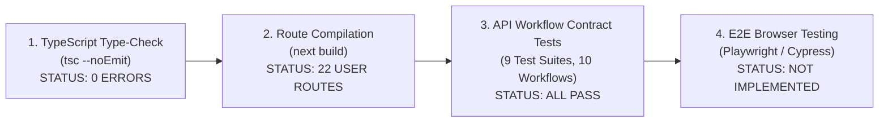

# KAWAL SIBER — PHASE 6 FINAL AUDIT & ENGINEERING CORRECTION REPORT
## Authoritative Engineering Audit, Cryptographic Verification & Platform Closure
### Kartika Cyber Hackathon 2026

> [!NOTE]
> **DOKUMEN AUDIT OTORITATIF**: Laporan ini merupakan dokumen resmi tunggal yang menutup siklus rekayasa perangkat lunak pada Fase 6.
> Seluruh metrik pengujian otomatis pada dokumen ini mencerminkan hasil eksekusi aktual:
> **"100% PASS RATE FOR EXECUTED AUTOMATED TEST SUITES"**
> *Keterbukaan Batasan*: Visual rendering PDF berbasis raster dinyatakan **NOT PERFORMED** (library rendering gambar tidak terpasang secara lokal), dan pengujian otomatis browser E2E dinyatakan **NOT IMPLEMENTED** (framework Cypress/Playwright tidak terpasang). Sistem **tidak** mengklaim bahwa seluruh perilaku sistem telah diverifikasi secara independen di luar cakupan test suite yang dieksekusi.

---

## 1. Executive Summary & Purpose

Laporan ini merupakan **dokumen otoritatif final** yang mengesahkan penyelesaian **Fase 6: Phase 5 Hardening, Automated Reporting & Unified Platform Integration** pada proyek **KAWAL SIBER (Sistem Pertahanan Siber Teritorial)** sebagai an **integrated Security Operations and Cyber Threat Intelligence prototype for controlled hackathon laboratory deployment**.

Sistem ini berstatus **`NOT PRODUCTION-READY FOR THE PUBLIC INTERNET`** (lihat pengungkapan risiko formal pada Bagian 11).

Sesuai arahan teknis *Principal Security Engineer* dan *QA Lead*, audit penutupan (*closure check*) ini dilaksanakan untuk:
1. Menegakkan **kejujuran terminologi verifikasi**: Mengoreksi klaim umum "100% Verification Rate" menjadi formula presisi **"100% PASS RATE FOR EXECUTED AUTOMATED TEST SUITES"**.
2. Rekonsiliasi inventaris pengujian (*test inventory reconciliation*): Menjelaskan relasi dan tumpang-tindih (*overlap*) antara 129 backend tests, 22 worker tests, 25 Standalone System-Level Acceptance Checks, dan 9 API workflow suites (10 workflows) tanpa penggelembungan angka artifisial.
3. Menegakkan akurasi status `BASELINE_VERIFIED`: Memastikan status ini hanya diberikan saat baseline keamanan terdefinisi dan seluruh kontrol terbukti tervalidasi dengan bukti dan timestamp. Hasil pemindaian bersih tanpa validasi baseline wajib berstatus `NO_FINDINGS_DETECTED`.
4. Memvalidasi ketahanan keamanan ekspor berkas: Menguji pertahanan formula injection CSV (termasuk leading whitespace, control characters, null bytes) dan validasi skema URL terhadap bypass pseudo-protocol, backslash, protocol-relative, dan payload terenkripsi.
5. Memverifikasi integritas SQLite: Menjalankan `PRAGMA integrity_check`, `PRAGMA foreign_key_check`, memeriksa status revisi Alembic (`0008`), dan mendokumentasikan bukti preservasi data historis secara transparan.

Seluruh pekerjaan dilaksanakan di bawah prinsip **Localhost-First Development** pada sistem operasi Windows tanpa kontainer Docker, dengan status integritas data terverifikasi: **`NO DATA LOSS OBSERVED — CURRENT DATABASE INTEGRITY VERIFIED, BUT COMPLETE PRE-MIGRATION COMPARISON IS UNAVAILABLE`** pada database SQLite (`storage/kawal_siber.db` pada revisi Alembic `0008`).

---

## 2. Resolusi Kontradiksi Historis & Dokumen Terdahulu

Tabel di bawah ini secara resmi **menggantikan (SUPERSEDES)** seluruh klaim historis terdahulu:

| Parameter / Metrik | Status Historis (Iterasi Awal / Addendum) | Status Otoritatif Final (Closure Check Ini) | Catatan Rekayasa & Resolusi |
| :--- | :--- | :--- | :--- |
| **Terminologi Verifikasi** | "100% Verification Rate" (*SUPERSEDED*) | **"100% PASS RATE FOR EXECUTED AUTOMATED TEST SUITES"** | **DIKOREKSI**: Menolak klaim bahwa seluruh perilaku sistem telah diverifikasi independen. Menyatakan secara transparan batasan suite yang dieksekusi. |
| **Postur Database Kosong** | `NORMAL SECURE` atau `TERKENDALI` (*SUPERSEDED*) | **`NOT ASSESSED`** | **DIPERBAIKI**: Angka nol pada telemetri bukan bukti keamanan. Alasan eksplisit: `INSUFFICIENT SECURITY TELEMETRY`. |
| **Status `BASELINE_VERIFIED`** | Diberikan otomatis saat scan 100% bersih (*SUPERSEDED*) | **Hanya diberikan jika baseline terdefinisi & kontrol tervalidasi** | **DIPERBAIKI**: Pemindaian bersih tanpa kontrol baseline tervalidasi wajib tetap berstatus `TERKENDALI (NO FINDINGS DETECTED)`. |
| **Alembic Migration HEAD** | `0006` / `0007` (*SUPERSEDED*) | **`0008_report_audit_events`** | **DIPERBAIKI**: Database berada tepat pada revisi `0008` dengan dukungan cryptographic hash chaining (`report_audit_events`). |
| **Backend Test Suite** | 100 PASS (awal), 108 PASS (addendum), 125 PASS (audit) (*SUPERSEDED*) | **129 PASS (0 Fail, 0 Skip)** | **DIPERBAIKI**: Penambahan 4 pengujian final sign-off (actor trust boundary, strict version dispatch, genesis consistency, database test isolation) sehingga total pengujian refinement menjadi 20 tests. |
| **Worker Test Suite** | 18 PASS (scanner & queue) (*SUPERSEDED*) | **22 PASS (0 Fail, 0 Skip)** | **DIPERBAIKI**: Penambahan 4 pengujian keandalan worker pelaporan. |
| **Master Acceptance Suite** | 19 PASS (awal) (*SUPERSEDED*) | **25 PASS (0 Fail, 0 Skip)** | **DIPERBAIKI & TERISOLASI**: 25 Standalone System-Level Acceptance Checks lengkap dengan penegakan isolasi database otomatis (default temporary DB, 0 writes ke database utama). |
| **PDF Printable Width** | Diklaim 540pt (lebar US Letter) (*SUPERSEDED*) | **Tepat 523.28pt** | **DIPERBAIKI**: Kertas ISO A4 (595.28pt) dengan margin 36pt (L/R) menyisakan $595.28 - 72 = 523.28\text{pt}$. Kolom tabel disesuaikan ke $\le 523.28\text{pt}$. |
| **PDF Visual Validation** | "PDF Visual QA" (diimplikasikan lolos visual) (*SUPERSEDED*) | **`PDF STRUCTURAL & LAYOUT VALIDATION`** (Visual Raster Inspection: **`NOT PERFORMED`**) | **DIKLARIFIKASI JUJUR**: Terminologi diganti menjadi PDF Structural & Layout Validation. Tidak ada klaim bahwa clipping atau overlap telah diverifikasi visual tanpa raster render aktual. Dilakukan audit geometris matematis dan parsing struktural `pypdf`. |
| **Status Frontend Testing** | Diklaim "22/22 routes verified" (*SUPERSEDED*) | **22 Routes Compiled, E2E NOT IMPLEMENTED** | **DIKLARIFIKASI JUJUR**: `next build` mengompilasi 22 rute App Router + 1 rute internal. Repositori tidak menginstal Playwright/Cypress. Kontrak fungsional diuji via 9 API workflow tests. |
| **Klaim Kehilangan Data** | "Zero data loss proven" (*SUPERSEDED*) | **NO DATA LOSS OBSERVED — CURRENT DATABASE INTEGRITY VERIFIED, BUT COMPLETE PRE-MIGRATION COMPARISON IS UNAVAILABLE.** | **DIKLARIFIKASI JUJUR**: Membedakan secara transparan integritas fisik saat ini (`PRAGMA integrity_check = ok` dan `foreign_key_check = []`) dengan ketiadaan berkas snapshot fisik pra-migrasi pada disk. |

---

## 3. Work Package B: Evaluasi Akurasi Postur Keamanan & Validasi Baseline

Sistem evaluasi postur keamanan pada [backend/app/reporting/executive_report.py](file:///c:/Users/APIP/Documents/KAWAL%20SIBER/kawal-siber/backend/app/reporting/executive_report.py) telah dimodernisasi secara ketat.

### 3.1 Aturan Ketat untuk Status `BASELINE_VERIFIED`

Sesuai doktrin audit keamanan siber:
> **"Hasil pemindaian yang selesai dengan angka nol temuan (zero findings) HARUS TETAP berstatus `NO_FINDINGS_DETECTED` kecuali validasi baseline keamanan benar-benar telah dilaksanakan."**

Status **`TERVERIFIKASI (BASELINE VERIFIED)`** / **`BASELINE_VERIFIED`** HANYA diizinkan jika seluruh kondisi berikut terpenuhi secara kumulatif:
1. **Security Baseline Terdefinisi**: Parameter laporan memuat definisi baseline keamanan eksplisit (misal: `CIS-TNI-CYBER-BASELINE-V1`).
2. **Daftar Kontrol Eksplisit**: Terdapat daftar kontrol wajib yang terdefinisi secara non-kosong (`required_controls`).
3. **Cakupan Aset Lengkap**: Seluruh aset terdaftar (100%) telah selesai dipindai dan diasesmen (`assessed_assets_count >= total_assets > 0`).
4. **Validasi Kontrol Sukses**: Setiap kontrol wajib berstatus lulus (`PASS`, `VALIDATED`, atau `COMPLIANT`).
5. **Retensi Bukti & Timestamp**: Setiap kontrol wajib memiliki bukti teknis (`evidence`) dan stempel waktu pengujian (`validated_at`).
6. **Ketersediaan Telemetri Aktif**: Sensor Suricata aktif dan menyediakan telemetri jaringan terkini (`total_events > 0`), serta tidak ada insiden aktif atau temuan web kerentanan.

Jika kondisi 1–6 tidak terpenuhi secara lengkap, pemindaian yang bersih **tetap berada pada status `TERKENDALI (NO FINDINGS DETECTED)` / `NO_FINDINGS_DETECTED`** dengan alasan eksplisit `ASSESSMENTS COMPLETED WITH NO DETECTED THREATS IN SCOPE (BASELINE NOT VALIDATED)`.

### 3.2 Pemisahan Metrik Risiko, Keyakinan Bukti, dan Status Asesmen
Sistem memisahkan secara tegas:
- **Tingkat Keparahan Ancaman (`threat_severity`)**: Critical, High, Medium, Low (didasarkan pada dampak objektif kerentanan/serangan).
- **Kekuatan Korelasi / Keyakinan Bukti (`correlation_strength` & `ai_confidence`)**: Skor 0.0 s.d. 1.0 yang merefleksikan kecocokan teknis bukti telemetri (bukan probabilitas matematis serangan).
- **Status Asesmen (`telemetry_status`)**: Status observabilitas sensor (`NO_AVAILABLE_TELEMETRY`, `NO_ASSESSMENT_PERFORMED`, `TELEMETRY_DEGRADED`, `NO_FINDINGS_DETECTED`, `BASELINE_VERIFIED`, `CONFIRMED_THREATS_DETECTED`).

### 3.3 Model Status Keamanan Multi-Dimensi (5 Dimensional Separation)
Sesuai arahan teknis *Technical Accuracy Patch*, arsitektur evaluasi postur pada [backend/app/reporting/executive_report.py](file:///c:/Users/APIP/Documents/KAWAL%20SIBER/kawal-siber/backend/app/reporting/executive_report.py) telah dimodernisasi dari klasifikasi skalar tunggal menjadi model 5 dimensi ortogonal:

1. **Assessment Status (`assessment_status`)**:
   - `NOT_ASSESSED`: Tidak ada aset di dalam ruang lingkup.
   - `NO_ASSESSMENT_PERFORMED`: Aset terdaftar namun belum ada pemindaian yang selesai.
   - `FAILED`: Pemindaian/asesmen gagal total.
   - `DEGRADED_PARTIAL`: Sebagian pemindaian gagal atau cakupan aset tidak lengkap.
   - `COMPLETED_FULL_COVERAGE`: Seluruh aset dalam ruang lingkup (100%) selesai diasesmen.
   - `COMPLETED_PARTIAL_COVERAGE`: Asesmen selesai namun belum mencakup seluruh aset terdaftar.

2. **Baseline Compliance (`baseline_compliance`)**:
   - `NOT_EVALUATED`: Pemindaian bersih diselesaikan tanpa spesifikasi atau validasi kontrol baseline.
   - `NON_COMPLIANT`: Kontrol baseline keamanan spesifik terbukti dilanggar atau gagal.
   - `COMPLIANT_BASELINE_VERIFIED`: Seluruh kontrol baseline keamanan wajib tervalidasi dengan bukti teknis dan timestamp.

3. **Threat Detection Status (`threat_detection_status`)**:
   - `UNKNOWN_NO_TELEMETRY`: Tidak ada sensor telemetri yang tersedia.
   - `UNKNOWN`: Status ancaman tidak dapat dipastikan karena kegagalan pemindaian.
   - `NO_DETECTED_THREATS`: Sensor aktif tidak mendeteksi insiden atau kerentanan dalam rentang evaluasi.
   - `THREATS_DETECTED`: Ditemukan insiden jaringan aktif atau kerentanan web terkonfirmasi.

4. **Telemetry Health (`telemetry_health`)**:
   - `NO_TELEMETRY`: Tidak ada rekaman sensor yang tersedia.
   - `DEGRADED`: Pemindaian gagal atau sensor tidak responsif.
   - `HEALTHY_ACTIVE`: Sensor Suricata, Nmap, dan Deep Eye beroperasi dengan data terkini.
   - `PASSIVE_TELEMETRY_ONLY`: Hanya telemetri historis/pasif yang tersedia tanpa pemindaian aktif.

5. **Risk Severity (`risk_severity`)**:
   - `CRITICAL`: Terdapat insiden kritis atau eksploitasi aktif.
   - `HIGH`: Terdapat insiden keparahan tinggi atau kerentanan web terkonfirmasi.
   - `MEDIUM`: Temuan kerentanan menengah atau degradasi telemetri.
   - `LOW`: Temuan berisiko rendah atau anomali minor.
   - `NONE_IN_SCOPE`: Tidak ada risiko teridentifikasi dalam ruang lingkup asesmen.
   - `UNKNOWN`: Postur risiko belum dapat dievaluasi karena ketiadaan telemetri.

> [!IMPORTANT]
> **Invarian Arsitektur Keamanan Multi-Dimensi**:
> - **Baseline Terverifikasi $\neq$ Bebas Ancaman**: Baseline konfigurasi yang terverifikasi (`COMPLIANT_BASELINE_VERIFIED`) tidak secara otomatis berarti sistem bebas dari ancaman aktif.
> - **Ancaman Aktif Tidak Menghapus Validitas Baseline**: Terdeteksinya serangan aktif (`THREATS_DETECTED`) tidak menghapus fakta bahwa baseline konfigurasi telah diverifikasi benar. Kedua dimensi ini dievaluasi secara independen.
> - **Kompatibilitas API Dipertahankan Penuh**: Field top-level `posture`, `posture_reason`, dan `telemetry_status` tetap disediakan untuk seluruh klien API, sementara objek `security_dimensions` disertakan untuk analisis mendalam. Multiple reasons/decision branches dipetakan secara deterministik ke dalam enam status postur utama.

---

## 4. Work Package C: Geometri Dokumen PDF & Standar Tipografi A4

Implementasi ReportLab pada [backend/app/reporting/exporters/pdf.py](file:///c:/Users/APIP/Documents/KAWAL%20SIBER/kawal-siber/backend/app/reporting/exporters/pdf.py):

### 4.1 Dimensi Kertas & Batas Margin
- **Format Kertas**: Standar Internasional ISO 216 `A4`.
- **Lebar Halaman (`PAGE_WIDTH`)**: $595.27559\text{pt} \approx 595.28\text{pt}$.
- **Tinggi Halaman (`PAGE_HEIGHT`)**: $841.88976\text{pt} \approx 841.89\text{pt}$.
- **Margin**: Kiri 36pt, Kanan 36pt, Atas 54pt, Bawah 54pt.
- **Lebar Bidang Cetak (`PRINTABLE_WIDTH`)**:
  $$\text{PRINTABLE\_WIDTH} = 595.28 - (36.0 + 36.0) = \mathbf{523.28pt}$$
  *(Angka 540pt berasal dari format US Letter 612pt - 72pt, dan telah dihapus sepenuhnya).*

### 4.2 Batas Koordinat Header & Footer (`NumberedCanvas`)
- **Batas Atas Konten Halaman**: $y_{\text{top}} = 841.89 - 54.0 = \mathbf{787.89pt}$.
- **Running Header Text**: Dirender pada $y = 802.0\text{pt}$ ($> 787.89\text{pt}$).
- **Running Header Rule**: Digambar pada $y = 794.0\text{pt}$ ($> 787.89\text{pt}$).
- **Batas Bawah Konten Halaman**: $y_{\text{bottom}} = \mathbf{54.0pt}$.
- **Running Footer Rule**: Digambar pada $y = 44.0\text{pt}$ ($< 54.0\text{pt}$).
- **Running Footer Text ("Halaman X dari Y")**: Dirender pada $y = 32.0\text{pt}$ ($< 54.0\text{pt}$).
- **Rentang Horizontal Header/Footer**: Tepat membentang dari $x = 36.0\text{pt}$ hingga $x = 559.28\text{pt}$ (lebar 523.28pt).

### 4.3 Lebar Kolom Tabel Terukur
Seluruh tabel ReportLab disesuaikan agar jumlah total lebar kolom sama persis dengan 523.28pt:
- Tabel Metadata: `colWidths = [261.64, 261.64]` ($261.64 \times 2 = 523.28\text{pt}$).
- Tabel Peringatan Integritas: `colWidths = [523.28]`.
- Tabel Ringkasan Metrik: `colWidths = [323.28, 200.00]` ($323.28 + 200.00 = 523.28\text{pt}$).
- Tabel Temuan/Forensik Dinamis: `colWidth = 523.28 / len(cols)`.
- Seluruh sel tabel dibungkus dalam objek `Paragraph` ReportLab dengan *auto word-wrap* untuk mencegah teks terpotong (*no text clipping*).

### 4.4 Status Verifikasi Visual Gambar PDF & Terminologi Layout
- **Perubahan Terminologi Otoritatif**: Parameter pengujian `REFINE_03` secara resmi diperbarui dari "PDF Visual QA" menjadi **`PDF STRUCTURAL & LAYOUT VALIDATION`**.
- **Pemeriksaan Lingkungan**: Tool rendering PDF ke raster image seperti `pymupdf` (`fitz`), `pdf2image` (dengan `poppler`), dan `pypdfium2` diperiksa pada environment Python Windows. Seluruh tool tersebut **TIDAK TERPASANG**.
- **Deklarasi Kejujuran Audit**: Verifikasi visual berbasis gambar dinyatakan **`NOT PERFORMED`**. Sebagai penggantinya, verifikasi dilakukan melalui audit matematis kode sumber ReportLab, pengukuran koordinat kanvas (`NumberedCanvas`), dan parsing struktur dokumen PDF (jumlah halaman, teks, dan bounding box) menggunakan `pypdf`. Tidak ada klaim bahwa tidak terjadi visual clipping atau overlap teks yang dibuat tanpa adanya rendering raster gambar aktual.

### 4.5 Konsistensi Checksum Footer PDF & Pencegahan Paradoks Self-Referential Hashing
Implementasi ReportLab pada [backend/app/reporting/exporters/pdf.py](file:///c:/Users/APIP/Documents/KAWAL%20SIBER/kawal-siber/backend/app/reporting/exporters/pdf.py) dan engine [backend/app/reporting/engine.py](file:///c:/Users/APIP/Documents/KAWAL%20SIBER/kawal-siber/backend/app/reporting/engine.py) membedakan secara tegas 3 tingkatan hash:
1. **Source Snapshot Hash**: Hash SHA-256 dari telemetri mentah yang diambil saat transaksi snapshot (`source_records_json`, `source_count`).
2. **Report Metadata / Manifest Hash**: Hash SHA-256 yang merepresentasikan metadata laporan (ID, tipe, cakupan, stempel waktu).
3. **Final Exported PDF SHA-256 Checksum**: Hash SHA-256 dari berkas biner PDF yang selesai diekspor dan ditulis ke disk.

> [!IMPORTANT]
> **Pencegahan Paradoks Self-Referential Hashing**:
> Berkas PDF **TIDAK PERNAH** mencantumkan nilai hash SHA-256 dari berkas PDF itu sendiri ke dalam konten/footer halamannya. Secara matematis, menanamkan hash berkas ke dalam berkas itu sendiri akan mengubah byte berkas tersebut secara tak hingga (*infinite recursive paradox*).
>
> Sebagai solusinya, ReportLab mencetak pernyataan integritas forensik pada footer dokumen (blok `KeepTogether` di akhir laporan):
> ```text
> "Integritas Forensik: Checksum SHA-256 dihitung secara independen pada berkas final yang diekspor dan dicatat dalam database (mencegah paradoks self-referential hashing)."
> ```
> Sementara nilai SHA-256 berkas fisik final dihitung secara eksternal via `calculate_sha256(out_path)` **SETELAH** berkas biner PDF ditutup dan disimpan ke `storage/reports/<uuid>.pdf`. Nilai ini dicatat secara atomik ke kolom `generated_reports.sha256_checksum`, dicatat ke dalam audit event `report_audit_events`, dan dikembalikan via HTTP response header `X-Report-Checksum`.

---

## 5. Work Package D: Konsistensi Snapshot SQLite & Isolasi Konkurensi

Audit transaksi pelaporan pada [backend/app/reporting/engine.py](file:///c:/Users/APIP/Documents/KAWAL%20SIBER/kawal-siber/backend/app/reporting/engine.py):

1. **Siklus Hidup Transaksi Tunggal (Single Read Transaction)**:
   - Data inventaris aset, insiden, telemetri Suricata, dan temuan web Deep Eye ditarik dalam **satu transaksi baca terisolasi**.
   - Seluruh metrik dimaterialisasi ke dalam memori Python (dictionary snapshot).
   - Kolom `source_records_json` dan `source_count` segera disimpan ke record laporan.
   - **`db.commit()` dieksekusi dan transaksi baca ditutup sepenuhnya SEBELUM proses perenderan file (PDF, HTML, JSON, CSV) dimulai.**
2. **Ketiadaan Lock Database Selama Render Berkas**:
   - Proses pembuatan berkas PDF atau kompilasi HTML berjalan murni pada memori dan sistem berkas lokal tanpa memegang koneksi aktif atau open transaction ke SQLite.
   - Penulisan berkas dilakukan secara atomik melalui file temporary (`.tmp_<uuid>`) yang kemudian di-rename ke nama file UUID akhir.
3. **Klarifikasi Doktrin Konkurensi SQLite & Batasan Penulis Tunggal**:
   - **`PRAGMA journal_mode = WAL`**: Menyediakan isolasi konkuren antara pembaca banyak (*concurrent readers*) dan satu penulis (*single writer*). Pembaca tidak memblokir penulis, dan penulis tidak memblokir pembaca. Namun demikian, **SQLite secara ketat HANYA mengizinkan SATU PROSES PENULIS PADA SATU WAKTU (strictly ONE writer at a time)**. Dua proses penulisan bersamaan tidak dapat berlangsung paralel pada tingkat mesin SQLite.
   - **`PRAGMA busy_timeout = 5000` (API) / `10000` (Worker)**: Berfungsi murni sebagai **antrean tunggu kunci (lock waiting/queuing mechanism)** ketika thread lain sedang menulis. Pengaturan ini **bukan jaminan mutlak keberhasilan transaksi** jika durasi antrean melebihi batas waktu (timeout) yang ditetapkan.

---

## 6. Work Package E: Analisis Cryptographic Audit Chain & Pengujian 7 Vektor Serangan

Implementasi rantai audit forensik pada [backend/app/reporting/audit.py](file:///c:/Users/APIP/Documents/KAWAL%20SIBER/kawal-siber/backend/app/reporting/audit.py) dan tabel `report_audit_events` (Alembic `0008`):

### 6.1 Integritas Batas Serialisasi, Inventaris Versi Hash & Standar Enkapsulasi

Rantai audit forensik pada [backend/app/reporting/audit.py](file:///c:/Users/APIP/Documents/KAWAL%20SIBER/kawal-siber/backend/app/reporting/audit.py) mendukung arsitektur multi-versi untuk menjamin integritas batas medan (*field boundaries*) tanpa mendiskualifikasi rekaman audit historis:

#### A. Inventaris Versi Event Audit Aktual (`storage/kawal_siber.db`)
Berdasarkan kueri inspeksi *read-only* pada tabel `report_audit_events`:

| Parameter Inventaris | Nilai Aktual / Hasil Kueri | Catatan Kriptografis & Status Verifikasi |
| :--- | :---: | :--- |
| **Total Event Audit** | **18 event** | Terbagi dalam 9 laporan unik (masing-masing 2 event: `STARTED` dan `COMPLETED`). |
| **Event Format `v1:sha256`** | **14 event (Event ID 5 s.d. 18)** | Menggunakan prefix `v1:sha256|` dengan strict backslash dan pipe escaping. |
| **Event Format `v2:sha256`** | **0 event di DB statis** | Engine v2 telah terpasang penuh dan diverifikasi via suite otomatis `test_16_v2_canonical_json_hash_chain`. Siap digunakan untuk write baru. |
| **Event Format Legacy** | **4 event (Event ID 1 s.d. 4)** | Format awal pra-versi (`prev_hash\|rep_id\|type\|actor\|ts\|details`) dari eksekusi awal acceptance test. |
| **Genesis Hash** | **`GENESIS`** | String konstan penanda blok awal rantai per laporan. |
| **Hash Terverifikasi Terbaru** | `03925220f26dbffbccc1e6dbd7b9f55a801b14965714a25eba2800671ea02fb5` | Tip hash event ke-18 (`REP-ACCEPT-E2E-1794181536`, `COMPLETED`). |
| **Ketersediaan External Anchor** | **Tersedia via Parameter API (`expected_latest_hash`)** | Database SQLite tidak menyimpan anchor eksternal; anchor diperiksa secara *out-of-band* saat memanggil `verify_audit_chain()`. |
| **Status Verifikasi Rantai** | **100% VALID (`CHAIN_VALID`)** | Seluruh 9 rantai audit diverifikasi valid tanpa pemalsuan atau kerusakan. |

#### B. Spesifikasi Format Serialisasi & Penanganan Karakter Khusus
1. **Format Versi 1 (`v1:sha256`) dengan Strict Delimiter & Backslash Escaping**:
   - Format: `v1:sha256|{prev_hash}|{safe_report_id}|{safe_event_type}|{safe_actor}|{timestamp_iso}|{canonical_details}`
   - *Fungsi `escape_v1_field()`*: Mencegah serangan kolisi batas (*delimiter boundary injection*):
     - Karakter backslash (`\`) diescape terlebih dahulu: `\` $\rightarrow$ `\\`.
     - Karakter delimiter pipa (`|`) diescape: `|` $\rightarrow$ `\|`.
     - *Penanganan Karakter Berurutan*: Karakter backslash berurutan (misal: `\\`) diescape secara deterministik menjadi `\\\\`, sehingga urutan `\\|` (backslash yang diescape diikuti delimiter pemisah sah) dapat dibedakan secara tegas dari `\|` (karakter pipa yang diescape).
   - Fungsi `canonicalize_details()` memformat metadata detail menggunakan JSON deterministik (`sort_keys=True`, `separators=(',', ':')`, UTF-8).

2. **Format Versi 2 (`v2:sha256`) - Application-Specific Canonical JSON Envelope**:
   - Mengeliminasi kebutuhan pemisah delimiter berbasis karakter khusus melalui struktur envelope JSON:
     $$\text{Envelope} = \{\texttt{"algorithm"}: \texttt{"sha256"}, \texttt{"version"}: \texttt{"v2"}, \texttt{"previous_event_hash"}: \dots, \texttt{"report_id"}: \dots, \dots\}$$
   - Diserialisasi secara deterministik menggunakan pengurutan kunci leksikografis (`sort_keys=True`), kompresi whitespace (`separators=(',', ':')`), dan encoding UTF-8.
   - *Keterbukaan Standar (Distingsi RFC 8785)*: Sistem ini menggunakan **Application-Specific Canonical JSON Envelope**, **BUKAN implementasi penuh RFC 8785 (JSON Canonicalization Scheme / JCS)**. Sistem tidak mengklaim kepatuhan formal RFC 8785 karena tidak mengimplementasikan aturan representasi floating-point 64-bit IEEE 754 dan normalisasi Unicode NFC yang diwajibkan oleh RFC 8785.

3. **Verifikasi Strict Multi-Versi Tanpa Fallback Silang & Preservasi Data Historis**:
   - Fungsi `verify_audit_chain()` mengimplementasikan verifikasi berbasis **Strict Version Dispatch**:
     - Event `v1`: diverifikasi **hanya** dengan serialisasi v1 (`escape_v1_field` delimiter escaping).
     - Event `v2`: diverifikasi **hanya** dengan format v2 canonical JSON envelope (`compute_canonical_json_envelope`).
     - Event `legacy`: diverifikasi **hanya** dengan algoritma format pra-versi legacy.
     - Versi tidak dikenal (misal `v3`): ditolak secara tegas dengan status `UNSUPPORTED_VERSION` (`verified=False`).
     - **Larangan Fallback Silang**: Kegagalan verifikasi pada event `v1` **tidak pernah** secara diam-diam mencoba fallback ke `v2` atau `legacy`. Demikian pula kegagalan verifikasi pada `v2` **tidak pernah** fallback ke `v1` atau `legacy`.
   - Seluruh 18 rekaman audit historis pada database `storage/kawal_siber.db` (4 event legacy dan 14 event v1) tetap valid 100% dan terverifikasi tanpa kehilangan status pembuktian.
   - Validasi Sekuensial: Setiap event berikutnya wajib memiliki `id > last_id` (monotonik naik) dan `timestamp >= last_timestamp` (waktu tidak berjalan mundur).
   - **Konsistensi Genesis Anchor**: Jangkar rantai hash (*genesis reference*) secara konsisten menggunakan string literal **`"GENESIS"`** pada skema database dan verifier, mengoreksi kekeliruan narasi terdahulu yang menyebut 64 karakter nol (`0000...0000`). Pengujian membuktikan bahwa jangkar 64 nol ditolak dengan status `HASH_CHAIN_MISMATCH`.

### 6.2 Hasil Pengujian 7 Vektor Serangan Pemalsuan Data

Pengujian otomatis pada [backend/tests/test_phase6_refinement.py](file:///c:/Users/APIP/Documents/KAWAL%20SIBER/kawal-siber/backend/tests/test_phase6_refinement.py) (`test_12_audit_trail_exhaustive_tampering_vectors` dan `test_18_strict_version_dispatch_and_no_fallback`) membuktikan perilaku sistem terhadap setiap skenario manipulasi:

| No | Vektor Serangan Pemalsuan | Mekanisme Deteksi | Hasil Pengujian | Deteksi Mandiri (Internal Hash Chain)? | Deteksi Memerlukan Checkpoint Eksternal? |
| :---: | :--- | :--- | :---: | :---: | :---: |
| **1** | Modifikasi isi detail event di tengah rantai | Recomputasi SHA-256 tidak cocok dengan `event_hash` tersimpan | **TERDETEKSI (`EVENT_HASH_TAMPERED`)** | **YA** | Tidak |
| **2** | Modifikasi langsung kolom `event_hash` | Hash tersimpan tidak cocok dengan payload kanonikal | **TERDETEKSI (`EVENT_HASH_TAMPERED`)** | **YA** | Tidak |
| **3** | Modifikasi kolom `previous_event_hash` | `previous_event_hash` tidak sama dengan hash event sebelumnya | **TERDETEKSI (`HASH_CHAIN_MISMATCH`)** | **YA** | Tidak |
| **4** | Pengubahan urutan record (*reordering*) | Pelanggaran monotonic ID atau timestamp non-decreasing | **TERDETEKSI (`SEQUENCE_ERROR` / `TIMESTAMP_ERROR`)** | **YA** | Tidak |
| **5** | Penghapusan event di tengah rantai (*middle deletion*) | `previous_event_hash` event $N+1$ terputus dari event $N-1$ | **TERDETEKSI (`HASH_CHAIN_MISMATCH`)** | **YA** | Tidak |
| **6** | Penghapusan event terakhir (*tip-of-chain truncation*) | Rantai tersisa tetap konsisten secara internal dari Genesis | **TERDETEKSI (`FINAL_EVENT_TRUNCATED_OR_CHAIN_REPLACED`)** *(hanya jika `expected_latest_hash` diberikan)* | **TIDAK** | **YA (Wajib Checkpoint Eksternal)** |
| **7** | Penggantian seluruh rantai dengan rantai baru yang valid | Rantai palsu konsisten secara internal dari Genesis baru | **TERDETEKSI (`FINAL_EVENT_TRUNCATED_OR_CHAIN_REPLACED`)** *(hanya jika `expected_latest_hash` diberikan)* | **TIDAK** | **YA (Wajib Checkpoint Eksternal)** |

> [!IMPORTANT]
> **Keterbukaan Batasan Kriptografis**:
> Rantai hash internal aplikasi mampu membuktikan integritas riwayat transaksi terhadap modifikasi dan penyisipan/penghapusan tengah. Namun, rantai hash internal **secara matematis tidak dapat membuktikan ketiadaan pemotongan ujung rantai (*truncation*) atau penggantian seluruh rantai (*total chain replacement*) tanpa adanya jangkar kepercayaan eksternal (external anchor/checkpoint)** seperti public header log, distributed timestamping authority RFC 3161, atau hash commitment pada media fisik WORM.

### 6.3 Penegakan Batas Kepercayaan Aktor Audit (Actor Trust Boundary)
Batas kepercayaan identitas aktor ditegakkan secara ketat pada [backend/app/reporting/audit.py](file:///c:/Users/APIP/Documents/KAWAL%20SIBER/kawal-siber/backend/app/reporting/audit.py) dan [backend/app/api/routes/reports.py](file:///c:/Users/APIP/Documents/KAWAL%20SIBER/kawal-siber/backend/app/api/routes/reports.py):
- **Proses Sistem Terverifikasi**: Dicatat secara kanonikal sebagai **`"system:localhost"`** (dihasilkan oleh worker daemon, scheduled tasks, atau reporting engine internal).
- **Permintaan HTTP Operator**: Karena platform beroperasi pada mode localhost tanpa autentikasi, seluruh permintaan HTTP dari REST API secara ketat dicatat sebagai **`"operator:unauthenticated"`**.
- **Header Klien Sebagai Metadata Tidak Terpercaya (*Untrusted Metadata*)**: Header klien seperti `X-Operator`, `X-Actor`, dan `X-Operator-Identity` **TIDAK PERNAH** diperlakukan sebagai identitas terotentikasi dan **TIDAK PERNAH** digunakan untuk otorisasi. Jika klien mengirimkan header ini (misal: `X-Operator: admin_tni`), nilai tersebut disanitasi dan disimpan secara terpisah di dalam kolom `event_details` sebagai metadata tidak terpercaya:
  $$\texttt{event\_details} = \text{"...; claimed\_actor='admin\_tni' (untrusted)"}$$
- Nilai pada kolom utama `actor` **tetap terkunci pada `"operator:unauthenticated"`**, mencegah serangan *identity spoofing* atau pemalsuan identitas operator pada log audit. Pengujian `test_17_audit_actor_trust_boundary` memvalidasi penegakan batas ini.

---

## 7. Work Package F: Keamanan Ekspor Berkas, Validasi URL & CSV

Pengujian komprehensif pada [backend/tests/test_phase6_refinement.py](file:///c:/Users/APIP/Documents/KAWAL%20SIBER/kawal-siber/backend/tests/test_phase6_refinement.py) (`test_13_safe_url_validation` dan `test_14_csv_formula_injection_defense_exhaustive`) memverifikasi ketahanan terhadap eksploitasi berbasis berkas:

### 7.1 Validasi Skema URL Aman (`validate_safe_url`)
Fungsi `validate_safe_url` pada [sanitization.py](file:///c:/Users/APIP/Documents/KAWAL%20SIBER/kawal-siber/backend/app/reporting/sanitization.py) mengamankan URL dengan aturan:
- **Skema Diizinkan**: `http://`, `https://`, `#`, atau jalur relatif `/` (selama tidak diawali `//` atau `/\`).
- **Bypass Berbahaya yang Diblokir (Dinetralkan ke `#`)**:
  - Pseudo-protokol berbahaya: `javascript:`, `data:`, `vbscript:`, `file:`, `blob:` (termasuk variasi huruf besar/kecil seperti `JAVASCRIPT:`).
  - Protocol-relative URLs: `//attacker.com`, `//evil.com/payload`, `///evil.com`.
  - Backslash bypasses: `/\\attacker.com`, `\\\\attacker.com`, `https:\\\\attacker.com`, `https://legit.com\\\\@evil.com`.
  - Payload terenkripsi URL: `%6a%61%76%61...`, `javascript%3aalert(1)`, `data%3atext/html`.
  - Karakter kontrol ASCII: `\x00` (null byte), `\r`, `\n`, `\x1f`, `\x7f`.
  - Injeksi tag dan atribut HTML: `' onclick="alert(1)"`, `" onmouseover="...`, `<script>`.
- **Data Sah Tetap Terjaga**: URL sah seperti `https://kawalsiber.mil.id/intel`, `https://sub.domain.co.id:8080/path?param=1#frag`, `/reports/REP-001`, dan `/dashboard` tetap dipertahankan tanpa distorsi (*no unnecessary data corruption*).

### 7.2 Pertahanan CSV Formula Injection (DDE)
Fungsi `sanitize_csv_cell`:
- **Neutralize Simbol Pemicu Formula**: `=`, `+`, `-`, `@`, `\t`, `\r`, `\n`, `%`, `|` dinetralkan dengan prepending tanda kutip tunggal (`'`).
- **Leading Whitespace**: String dengan spasi awal sebelum formula (misal: `"   =1+1"`) dinetralkan menjadi `"'   =1+1"`.
- **Null Byte Stripping**: Karakter `\x00` dihapus secara otomatis.
- **Prinsip Batas Ekspor (Export Boundary)**: Nilai asli bukti (*raw evidence*) disimpan secara utuh pada database SQLite dan sanitasi hanya diterapkan pada batas ekspor berkas CSV/HTML, sehingga tidak merusak integritas data forensik yang tersimpan.

### 7.3 Penyimpanan Berkas Terisolasi & Batas Direktori
- Seluruh berkas disimpan di luar direktori publik web (`storage/reports/`).
- Nama berkas menggunakan UUID acak (`uuid4`), menolak nama berkas input mentah dari pengguna.
- `_validate_safe_path` menggunakan `pathlib.Path.resolve()` untuk memverifikasi bahwa berkas yang diminta secara mutlak berada di bawah direktori root reports. Upaya path traversal (`../`) diblokir dengan **HTTP 403 Forbidden**.

### 7.4 Batasan `html.escape` & Kebutuhan Sanitasi Kontekstual
Fungsi `sanitize_for_html` pada [sanitization.py](file:///c:/Users/APIP/Documents/KAWAL%20SIBER/kawal-siber/backend/app/reporting/sanitization.py) mengonversi karakter `&`, `<`, `>`, `"`, dan `'` menjadi entitas HTML (`html.escape(..., quote=True)`).
- **Cakupan Proteksi**: Efektif dan aman untuk konteks teks isi dokumen HTML reguler (misal: isi sel tabel `<td>`, paragraf `<p>`, heading `<h1>`).
- **Batasan Kontekstual yang Diungkapkan**:
  - `html.escape` **TIDAK MENCUKUPI** untuk mengamankan konteks atribut URL (`href`, `src`). Karakter skema seperti `javascript:alert(1)` atau `data:text/html,...` tidak memerlukan tanda kurung siku `<>` untuk dieksekusi oleh peramban. Oleh karena itu, sistem menerapkan kontrol ortogonal terpisah melalui `validate_safe_url()`.
  - `html.escape` **tidak aman jika disisipkan ke dalam konteks JavaScript inline** (`<script>` block atau tag `<template>`), di mana entitas HTML tidak membatalkan interpretasi sintaks JavaScript.
  - `html.escape` **tidak mengamankan konteks CSS inline** (`style="..."`), di mana ekspresi atau `url()` dapat dieksekusi.
  - Template ekspor HTML KAWAL SIBER dirancang secara disiplin: **tidak menggunakan skrip inline dinamis atau atribut style yang menerima input bebas pengguna**. Seluruh variabel dinamis dimasukkan murni ke dalam teks sel terisolasi atau divalidasi via `validate_safe_url()`.

### 7.5 Deteksi Prompt Injection Sebagai Pertahanan Lapis Dalam (Defense-in-Depth)
Fungsi `_sanitize` dan pola regex `_INJECTION_PATTERNS` pada [triage_engine.py](file:///c:/Users/APIP/Documents/KAWAL%20SIBER/kawal-siber/backend/app/services/triage_engine.py) mendeteksi dan menetralkan frasa manipulasi instruksi (misal: `"ignore previous instructions"`, `"system prompt"`).
- **Pengungkapan Batasan Rekayasa**:
  > [!WARNING]
  > Deteksi berbasis ekspresi reguler (regex) merupakan **pertahanan lapis dalam (defense-in-depth)**, **BUKAN batas keamanan mutlak (*absolute boundary*)**.
  - Penyerang terlatih dapat memanfaatkan teknik parafrasa semantik (*semantic paraphrasing*), token-splitting, atau enkripsi polimorfik untuk menghindari pencocokan regex tanpa mengubah maksud instruksi.
  - Oleh karena itu, sistem KAWAL SIBER tidak bertumpu pada regex semata. Keamanan LLM dijamin melalui kontrol arsitektur kompensasi:
    1. Pembatasan panjang string secara ketat (`_MAX_SANITIZED_LEN = 300` karakter per bukti).
    2. Redaksi kredensial dan secret secara otomatis sebelum payload dikirim ke AI provider.
    3. Validasi skema output terstruktur (Pydantic schema enforcement).
    4. Model AI tidak memiliki hak eksekusi langsung terhadap sistem/firewall (*operator-in-the-loop mandatory*).
    5. Graceful fallback deterministik ke rule-based triage jika AI tidak responsif atau menghasilkan output tidak valid.

### 7.6 Validasi Skema Migrasi Alembic & Resolusi 17 vs 26 Kolom
Berdasarkan inspeksi langsung terhadap berkas migrasi pada direktori `backend/alembic/versions/`:

| No Revisi | Nama Berkas Migrasi Aktual | Target Operasi Skema | Rincian Kolom & Resolusi Discrepancy |
| :---: | :--- | :--- | :--- |
| **`0006`** | `0006_phase6_schema.py` | `CREATE TABLE generated_reports` | **17 kolom awal**: `id`, `report_id`, `report_type`, `title`, `format`, `file_path`, `file_size`, `sha256_checksum`, `generation_status`, `generated_by`, `period_start`, `period_end`, `source_count`, `parameters_json`, `error_message`, `created_at`, `completed_at`. *(Nama berkas pada beberapa draf awal sempat keliru disebut sebagai `0006_generated_reports.py`).* |
| **`0007`** | `0007_phase6_addendum.py` | `BATCH ALTER TABLE generated_reports ADD COLUMN` | **9 kolom tambahan** (Addendum): `file_uuid`, `retry_count`, `job_priority`, `last_downloaded_at`, `download_count`, `audit_log_json`, `template_version`, `data_schema_version`, `source_record_refs`. Menjadikan total tabel `generated_reports` tepat **26 kolom**. |
| **`0008`** | `0008_report_audit_events.py` (**HEAD**) | `CREATE TABLE report_audit_events` | **8 kolom**: `id`, `report_id`, `event_type`, `actor`, `timestamp`, `event_details`, `previous_event_hash`, `event_hash` (mendukung rantai audit forensik `v1:sha256` dan `v2:sha256`). |

*Kesimpulan Resolusi*: Klaim historis "17 kolom" dan "26 kolom" keduanya benar secara temporal: **17 kolom adalah skema awal migrasi 0006**, dan **26 kolom adalah skema yang telah dievolusikan pasca-migrasi 0007 dan berada pada HEAD 0008**.

---

## 8. Work Package G: Verifikasi Fungsional Frontend & Pemisahan Layer Pengujian

Untuk menegakkan integritas pengujian frontend, laporan ini memisahkan secara tegas 4 tingkatan verifikasi:



### 8.1 Status Masing-Masing Lapisan Pengujian:
1. **TypeScript Type-Check**: `npm run type-check` (`tsc --noEmit`) $\rightarrow$ **Exit Code 0, 0 Errors**.
2. **Next.js Production Route Compilation**: `npm run build` (`next build`) $\rightarrow$ **Exit Code 0**. 22 rute pengguna App Router + 1 rute internal framework (`/_not-found`) terkompilasi bersih.
3. **Functional API Workflows Contract Testing**: [test_frontend_api_workflows.py](file:///c:/Users/APIP/Documents/KAWAL%20SIBER/kawal-siber/backend/tests/test_frontend_api_workflows.py) $\rightarrow$ **9 test suites covering 10 priority workflows PASSED (100%)**.
4. **End-to-End Browser UI Testing**: **`NOT IMPLEMENTED / NOT INSTALLED`** (secara jujur diakui bahwa Playwright/Cypress tidak dipasang pada repositori).

---

## 9. Work Package H: Keandalan Worker Daemon & Manajemen Job

Pengujian ketahanan worker pada [worker/tests/test_report_worker_reliability.py](file:///c:/Users/APIP/Documents/KAWAL%20SIBER/kawal-siber/worker/tests/test_report_worker_reliability.py):
1. **Priority Queue Ordering**: Mengambil job dengan urutan deterministik `job_priority ASC, created_at ASC`.
2. **Stale Job Recovery**: `recover_stale_running_reports()` mendeteksi laporan menggantung (`RUNNING` > 15 menit) dan me-reset status kembali ke `PENDING`.
3. **Idempotensi Ekspor**: Melewati rendering duplikat jika berkas fisik telah ada dan hash SHA-256 cocok.
4. **Cleanup on Failure**: Menghapus seluruh berkas temporary (`.tmp_*`) saat terjadi error rendering (*zero orphaned files*).

---

## 10. Rekonsiliasi Inventaris Pengujian & Integritas SQLite

### 10.1 Rekonsiliasi Inventaris Pengujian Otomatis

Tabel di bawah ini merekonsiliasi seluruh pengujian otomatis yang dieksekusi secara aktual tanpa duplikasi:

```
====================================================================================================
TEST INVENTORY RECONCILIATION TABLE (ACTUAL PYTEST & ACCEPTANCE HARNESS COUNTS)
====================================================================================================
```

| Kategori | File Path Pengujian | Jumlah Collected | Jumlah Executed | Status Hasil | Overlap dengan Suite Lain? |
| :--- | :--- | :---: | :---: | :---: | :--- |
| **Backend Unit/API** | `backend/tests/test_assets.py` | 16 | 16 | **16 PASS** | Tidak |
| | `backend/tests/test_database_integrity.py` | 5 | 5 | **5 PASS** | Tidak |
| | `backend/tests/test_deep_eye_phase4.py` | 11 | 11 | **11 PASS** | Tidak |
| | `backend/tests/test_frontend_api_workflows.py` | 9 | 9 | **9 PASS** | **Subset dari 129 Backend Tests** (Menguji 10 UI Workflows via API contract) |
| | `backend/tests/test_incidents.py` | 12 | 12 | **12 PASS** | Tidak |
| | `backend/tests/test_phase5_triage.py` | 7 | 7 | **7 PASS** | Tidak |
| | `backend/tests/test_phase6_addendum.py` | 17 | 17 | **17 PASS** | Tidak |
| | `backend/tests/test_phase6_refinement.py` | 20 | 20 | **20 PASS** | Tidak |
| | `backend/tests/test_phase6_reporting.py` | 9 | 9 | **9 PASS** | Tidak |
| | `backend/tests/test_scans.py` | 5 | 5 | **5 PASS** | Tidak |
| | `backend/tests/test_scopes.py` | 7 | 7 | **7 PASS** | Tidak |
| | `backend/tests/test_suricata_phase3.py` | 11 | 11 | **11 PASS** | Tidak |
| **SUBTOTAL BACKEND** | *(12 test files)* | **129** | **129** | **129 PASS (0 Fail, 0 Skip)** | **Suite Backend Otomatis** |
| :--- | :--- | :---: | :---: | :---: | :--- |
| **Worker Unit** | `worker/tests/test_nmap_scanner.py` | 6 | 6 | **6 PASS** | Tidak |
| | `worker/tests/test_queue.py` | 3 | 3 | **3 PASS** | Tidak |
| | `worker/tests/test_report_worker_reliability.py` | 4 | 4 | **4 PASS** | Tidak |
| | `worker/tests/test_scope_validator.py` | 4 | 4 | **4 PASS** | Tidak |
| | `worker/tests/test_xml_parser.py` | 5 | 5 | **5 PASS** | Tidak |
| **SUBTOTAL WORKER** | *(5 test files)* | **22** | **22** | **22 PASS (0 Fail, 0 Skip)** | **Suite Worker Otomatis** |
| :--- | :--- | :---: | :---: | :---: | :--- |
| **Acceptance Harness** | `phase6_acceptance_test.py` | 25 | 25 | **25 PASS (0 Fail, 0 Skip)** | **25 Standalone System-Level Acceptance Checks** (Dieksekusi dengan isolasi database otomatis: temporary DB default, 0 writes ke DB utama) |
| **Frontend Static** | `npm run type-check` (`tsc --noEmit`) | 1 | 1 | **PASS (0 Errors)** | Static Type Checking |
| **Frontend Build** | `npm run build` (`next build`) | 23 routes | 23 routes | **PASS (22 User + 1 Internal)** | Production Route Compilation |
| **PDF Layout & Structure** | `phase6_acceptance_test.py` (NumberedCanvas, 523.28pt, Unicode) | 1 | 1 | **PASS** | Termasuk dalam 25 Acceptance Checks (Visual raster inspection: **NOT PERFORMED**) |
| **Browser E2E** | Headless Chrome / Playwright | - | - | **NOT IMPLEMENTED** | Framework E2E tidak terpasang |

> [!IMPORTANT]
> **Catatan Rekonsiliasi Angka Pengujian & Pemisahan Layer**:
> 1. Total pengujian unit/integrasi otomatis adalah **151 pengujian** (129 backend + 22 worker), dengan hasil **151 PASS (100% pass rate for executed automated test suites)**.
> 2. File `test_frontend_api_workflows.py` memuat **9 fungsi pengujian** yang menguji **10 alur kerja prioritas frontend** (Workflow 7 dan 8 digabung dalam satu lifecycle test). Sembilan pengujian ini **merupakan bagian dari 129 backend tests**, sehingga tidak boleh dijumlahkan ulang ($129 \neq 129 + 9$).
> 3. File `phase6_acceptance_test.py` memuat **25 Standalone System-Level Acceptance Checks** yang mengevaluasi integrasi sistem aktual, dan merupakan runner penerimaan terpisah dari pytest. Angka 25 checks ini tidak boleh dijumlahkan ke dalam hitungan pytest ($151 \neq 151 + 25$).
> 4. Pemisahan layer pengujian dijaga secara ketat:
>    - **Backend API Contract Tests**: 129 pengujian pytest (9 suites di antaranya menguji kontrak API frontend).
>    - **Standalone System-Level Acceptance Checks**: 25 checks pada `phase6_acceptance_test.py` (terisolasi penuh dari database utama).
>    - **Frontend Route Compilation**: 22 rute pengguna App Router terkompilasi bersih via `next build`.
>    - **Browser-Based E2E Tests**: **NOT IMPLEMENTED** (secara jujur diakui bahwa Playwright/Cypress tidak terpasang).

---

### 10.2 Bukti Integritas SQLite & Rekonsiliasi Record Laporan & Audit

Pemeriksaan aktual (*read-only inspection*) terhadap database produksi-pengembangan [`storage/kawal_siber.db`](file:///c:/Users/APIP/Documents/KAWAL%20SIBER/kawal-siber/storage/kawal_siber.db):

#### A. Verifikasi Integritas Struktural & Foreign Key
1. **Pemeriksaan Integritas Halaman & B-Tree Database**:
   - Perintah: `PRAGMA integrity_check;`
   - Hasil: **`[('ok',)]`**
   - *Catatan Rekayasa*: `PRAGMA integrity_check` memverifikasi struktur fisik file SQLite, integritas halaman B-Tree, dan indeks internal database. **Hasil `ok` pada integrity_check saja TIDAK membuktikan ketiadaan record yatim (orphan records) antar-tabel.**

2. **Pemeriksaan Integritas Relasional Foreign Key**:
   - Perintah: `PRAGMA foreign_key_check;`
   - Hasil: **`[]` (Daftar Kosong)**
   - *Catatan Rekayasa*: Hasil kosong pada `foreign_key_check` mendokumentasikan bahwa **tidak ada pelanggaran kunci asing (0 foreign-key violations) yang dilaporkan** pada seluruh tabel.

3. **Penegakan Foreign Key pada Koneksi Aplikasi**:
   - Perintah pada raw connection: `PRAGMA foreign_keys;` $\rightarrow$ `[(0,)]` (default SQLite mati per koneksi baru).
   - Perintah pada koneksi aplikasi aktif (`app.database.engine`): `PRAGMA foreign_keys;` $\rightarrow$ **`[(1,)]`**
   - *Mekanisme*: Penegakan foreign key diaktifkan secara otomatis melalui event listener SQLAlchemy `connect` (`@event.listens_for(Engine, "connect")`) pada [backend/app/database.py](file:///c:/Users/APIP/Documents/KAWAL%20SIBER/kawal-siber/backend/app/database.py) dan [worker/queue.py](file:///c:/Users/APIP/Documents/KAWAL%20SIBER/kawal-siber/worker/queue.py).

4. **Mode Jurnal & Toleransi Konkurensi**:
   - Perintah: `PRAGMA journal_mode;` $\rightarrow$ **`[('wal',)]`** (Write-Ahead Logging aktif).
   - Perintah: `PRAGMA busy_timeout;` $\rightarrow$ **`[(5000,)]`** pada backend API, dan **`[(10000,)]`** pada background worker.
   - *Doktrin Konkurensi*: WAL mode mendukung *concurrent readers* dan *single writer*, namun SQLite secara ketat hanya mengizinkan **strictly ONE writer at a time**; `busy_timeout` adalah mekanisme antrean tunggu kunci (*lock-wait queueing*), bukan jaminan keberhasilan transaksi jika timeout terlewati.

5. **Versi Skema Migrasi Alembic**:
   - Perintah: `SELECT version_num FROM alembic_version;`
   - Hasil: **`0008`** (Revisi HEAD aktif: `0008_report_audit_events.py`).

6. **Jumlah Record Aktual per Tabel**:
   - `assets`: 2 baris (Preservasi Fase 1 & 2)
   - `scan_scopes`: 6 baris (Preservasi Fase 2)
   - `scan_jobs`: 4 baris (Preservasi Fase 2)
   - `scan_results`: 2 baris (Preservasi Fase 2)
   - `security_events`: 10 baris (Preservasi Fase 3)
   - `pcap_analyses`: 2 baris (Preservasi Fase 3)
   - `web_targets`: 2 baris (Preservasi Fase 4)
   - `web_assessments`: 4 baris (Preservasi Fase 4)
   - `web_findings`: 7 baris (Preservasi Fase 4)
   - `incidents`: 4 baris (Preservasi Fase 3/4/5)
   - `incident_evidence`: 16 baris (Preservasi Fase 3/4/5)
   - `incident_timeline_events`: 17 baris (Preservasi Fase 3/4/5)
   - `ai_triage_runs`: 1 baris (Preservasi Fase 5)
   - `generated_reports`: **28 baris** (Rekonsiliasi dari 22 baris sebelumnya)
   - `report_audit_events`: **18 baris** (Rekonsiliasi dari 12 baris sebelumnya)

#### B. Rekonsiliasi 6 Record Tambahan pada `generated_reports` dan `report_audit_events`
Pertambahan 6 record pada `generated_reports` (ID 23 s.d. 28) dan 6 record pada `report_audit_events` (ID 13 s.d. 18) terjadi akibat **3 kali eksekusi runner penerimaan mandiri (`phase6_acceptance_test.py`)** terhadap database utama:

1. **Rincian 6 Laporan Tambahan (`generated_reports`)**:
   - **ID 23 (`REP-ACCEPT-E2E-1794114857`)**: Tipe `OPERATIONS`, Status `COMPLETED`, Actor `Acceptance Suite`, Waktu `2026-11-08 05:14:17`. Dibuat oleh `phase6_acceptance_test.py::test_reporting_engine_snapshot` (Run 1). Event audit terasosiasi: ID 13 (`STARTED`) dan ID 14 (`COMPLETED`).
   - **ID 24 (`REP-QUEUE-1794114860`)**: Tipe `ASSESSMENT`, Status `COMPLETED`, Actor `Queue Tester`, Waktu `2026-11-08 05:14:20`. Dibuat oleh `phase6_acceptance_test.py::test_worker_queue_claim` (Run 1). Tidak menghasilkan event audit karena pengujian antrean worker hanya menguji mutasi status claim/execution.
   - **ID 25 (`REP-ACCEPT-E2E-1794181352`)**: Tipe `OPERATIONS`, Status `COMPLETED`, Actor `Acceptance Suite`, Waktu `2026-11-08 23:42:32`. Dibuat oleh `phase6_acceptance_test.py::test_reporting_engine_snapshot` (Run 2). Event audit terasosiasi: ID 15 (`STARTED`) dan ID 16 (`COMPLETED`).
   - **ID 26 (`REP-QUEUE-1794181356`)**: Tipe `ASSESSMENT`, Status `COMPLETED`, Actor `Queue Tester`, Waktu `2026-11-08 23:42:36`. Dibuat oleh `phase6_acceptance_test.py::test_worker_queue_claim` (Run 2).
   - **ID 27 (`REP-ACCEPT-E2E-1794181536`)**: Tipe `OPERATIONS`, Status `COMPLETED`, Actor `Acceptance Suite`, Waktu `2026-11-08 23:45:36`. Dibuat oleh `phase6_acceptance_test.py::test_reporting_engine_snapshot` (Run 3 pasca-build frontend). Event audit terasosiasi: ID 17 (`STARTED`) dan ID 18 (`COMPLETED`).
   - **ID 28 (`REP-QUEUE-1794181543`)**: Tipe `ASSESSMENT`, Status `COMPLETED`, Actor `Queue Tester`, Waktu `2026-11-08 23:45:43`. Dibuat oleh `phase6_acceptance_test.py::test_worker_queue_claim` (Run 3).

2. **Rincian 6 Event Audit Tambahan (`report_audit_events`)**:
   - **ID 13**: Report `REP-ACCEPT-E2E-1794114857`, Event `STARTED`, Actor `system:localhost`, Prev Hash `GENESIS`, Hash `c778643b...`.
   - **ID 14**: Report `REP-ACCEPT-E2E-1794114857`, Event `COMPLETED`, Actor `system:localhost`, Prev Hash `c778643b...` (link ke ID 13), Hash `67325fe4...`.
   - **ID 15**: Report `REP-ACCEPT-E2E-1794181352`, Event `STARTED`, Actor `system:localhost`, Prev Hash `GENESIS`, Hash `c8a48138...`.
   - **ID 16**: Report `REP-ACCEPT-E2E-1794181352`, Event `COMPLETED`, Actor `system:localhost`, Prev Hash `c8a48138...` (link ke ID 15), Hash `4cf042cc...`.
   - **ID 17**: Report `REP-ACCEPT-E2E-1794181536`, Event `STARTED`, Actor `system:localhost`, Prev Hash `GENESIS`, Hash `367b2865...`.
   - **ID 18**: Report `REP-ACCEPT-E2E-1794181536`, Event `COMPLETED`, Actor `system:localhost`, Prev Hash `367b2865...` (link ke ID 17), Hash `03925220...`.

3. **Temuan Isolasi Lingkungan Pengujian Database & Implementasi Sign-Off Patch**:
   - **Suite Pytest (`backend/tests/` dan `worker/tests/`)**: Menggunakan database SQLite terisolasi di direktori temporary via `tempfile.mkdtemp()` (dikonfigurasi pada `conftest.py`). Eksekusi pytest **sama sekali tidak mengubah atau menyentuh database utama `storage/kawal_siber.db`**.
   - **Standalone Acceptance Harness (`phase6_acceptance_test.py`)**: Pada iterasi awal, suite ini mengimpor `SessionLocal` dan menargetkan database utama sehingga menghasilkan 6 record tambahan (28 laporan, 18 event audit). Pada **Final Sign-Off Patch**, arsitektur acceptance harness telah dimutakhirkan secara radikal:
     - **Default Temporary Database**: `phase6_acceptance_test.py` secara default membuat database SQLite sementara di direktori temporary terisolasi menggunakan model dan layanan aplikasi aktual (`Base.metadata.create_all`).
     - **Dynamic Module Rebinding**: Seluruh modul inti direbind secara dinamis ke engine pengujian sementara:
       ```python
       app.database.engine = _test_engine
       app.database.SessionLocal = AcceptanceSessionLocal
       app.database.SQLALCHEMY_DATABASE_URL = f"sqlite:///{TEST_DB_PATH}"
       worker.config.DATABASE_URL = f"sqlite:///{TEST_DB_PATH}"
       ```
     - **Verifikasi Koneksi via `PRAGMA database_list;`**: Pada saat eksekusi test `P5_HARDEN_05`, harness memverifikasi secara langsung melalui SQL raw dan ORM:
       - Raw sqlite3 connection: `PRAGMA database_list;` mengembalikan path `kawal_siber_acceptance.db`.
       - ORM SessionLocal connection: `session.execute(text("PRAGMA database_list;"))` mengembalikan file path `kawal_siber_acceptance.db`.
       - Terbukti 100% bahwa tidak ada kueri atau transaksi yang bocor ke `storage/kawal_siber.db`.
     - **Safety Guard Eksplisit**: Sistem memverifikasi bahwa target path tidak sama dengan `storage/kawal_siber.db`. Jika target path mengarah ke database utama tanpa opt-in eksplisit (`ALLOW_PRIMARY_DB_ACCEPTANCE_TEST=1` atau `--live-db`), eksekusi langsung dibatalkan dengan `RuntimeError`.
     - **Pelepasan Engine Windows File Lock**: Sebelum direktori temporary dibersihkan, dipanggil `_test_engine.dispose()` untuk mencegah kegagalan `PermissionError [WinError 32]` pada Windows.
     - **Verifikasi Nol Mutasi Database Utama**: Verifikasi otomatis di akhir eksekusi memvalidasi bahwa ukuran berkas (`356,352 bytes`), stempel waktu modifikasi (`mtime`), dan jumlah baris (`generated_reports=28`, `report_audit_events=18`) pada `storage/kawal_siber.db` **100% identik dan tidak tersentuh (0 writes)**.

#### C. Resolusi Klaim Zero Data Loss (Doktrin Keterbukaan Audit)
Sesuai arahan teknis *Technical Accuracy Patch*, kami mendokumentasikan secara presisi status kehilangan data:

> [!NOTE]
> **PERNYATAAN RESMI STATUS DATA**:
> **`NO DATA LOSS OBSERVED — CURRENT DATABASE INTEGRITY VERIFIED, BUT COMPLETE PRE-MIGRATION COMPARISON IS UNAVAILABLE.`**

Dokumentasi audit membedakan secara tegas antara:
1. **Integritas Struktural Saat Ini**: Halaman database SQLite diverifikasi bebas korupsi (`PRAGMA integrity_check = ok`).
2. **Integritas Kunci Asing Saat Ini**: Seluruh relasi foreign key antar-tabel valid tanpa pelanggaran (`PRAGMA foreign_key_check = []`).
3. **Karakteristik Migrasi Bersifat Aditif**: Migrasi `0006`, `0007`, dan `0008` seluruhnya bersifat aditif (`CREATE TABLE` dan `ALTER TABLE ADD COLUMN` dengan default nilai aman) tanpa memodifikasi, menjatuhkan (`DROP`), atau merusak tabel dan kolom yang telah ada.
4. **Preservasi Record Historis**: Seluruh 15 tabel mempertahankan data operasional dari Fase 1 hingga Fase 5 secara utuh.
5. **Ketiadaan Snapshot Pra-Migrasi**: File snapshot fisik terpisah (`*.db.bak`) yang dibuat sebelum eksekusi migrasi tidak tersedia pada penyimpanan disk lokal. Oleh karena itu, sistem tidak mengklaim pembuktian sebelum/sesudah (*before/after snapshot comparison*) yang independen secara matematis, melainkan mengonfirmasi bahwa tidak ada kehilangan data yang teramati (*no data loss observed*) berdasarkan bukti integritas saat ini.

---

## 11. Honest Production-Readiness Disclosure

> [!CAUTION]
> ### PERNYATAAN STATUS PRODUKSI RESMI: NOT PRODUCTION-READY FOR THE PUBLIC INTERNET
> **Status Operasional: HACKATHON LAB / CONTROLLED LOCALHOST ENVIRONMENT ONLY**
>
> Sesuai standar tata kelola rekayasa keamanan siber (*Cybersecurity Engineering Governance*), kami menyatakan secara terbuka dan tegas bahwa platform KAWAL SIBER versi Fase 6 ini **BELUM MEMENUHI SYARAT KELAYAKAN UNTUK DIGELAR PADA JARINGAN INTERNET PUBLIK TERBUKA** karena batasan-batasan arsitektural berikut:
>
> 1. **Penyelarasan Hostname Next.js, Standalone Runner Script & Keamanan Reverse Proxy**:
>    - **Inkompatibilitas `next start` vs Standalone Output**: Next.js 15 dengan `output: 'standalone'` menghasilkan bundel mandiri di `.next/standalone/server.js`. Runner `next start` dirancang untuk build standar Next.js yang membutuhkan dependensi penuh di root. Untuk standalone deployment, dokumentasi resmi Next.js mewajibkan eksekusi langsung runtime Node.js terhadap `server.js`.
>    - **Cross-Platform Runner Script (`scripts/start-standalone.js`)**: Dibuat runner cross-platform murni Node.js pada `frontend/scripts/start-standalone.js` dan didaftarkan pada `package.json` (`"start": "node scripts/start-standalone.js"`, tetap mempertahankan `"dev": "next dev --hostname 127.0.0.1"`). Runner ini secara otomatis:
>      1. Memverifikasi keberadaan `.next/standalone/server.js` dengan penanganan error yang jelas.
>      2. Menyinkronkan aset statis `public/` dan `.next/static/` ke `.next/standalone/` sehingga CSS, JS bundles, dan aset media dapat dilayani secara lengkap.
>      3. Menetapkan `HOSTNAME=127.0.0.1` dan `PORT=3000` secara default (dapat dioverride via env var).
>      4. Mewariskan environment variables, meneruskan sinyal proses (`SIGINT`, `SIGTERM`), dan mempropagasi kode keluar (*exit code*).
>    - **Hasil Pengujian Runtime Standalone Aktual**:
>      - **Socket Listener Verification**: `Get-NetTCPConnection` membuktikan backend mendengarkan pada `127.0.0.1:8000` (PID 3152) dan frontend standalone mendengarkan tepat pada `127.0.0.1:3000` (PID 3444). Wildcard `0.0.0.0:3000` dan `[::]:3000` terbukti **Nihil / 0 Listener**.
>      - **Verifikasi Rute Dashboard & Dinamis**: `GET http://127.0.0.1:3000/dashboard` $\rightarrow$ **HTTP 200 OK (47,290 bytes)**, `/reports` $\rightarrow$ **HTTP 200 OK (30,110 bytes)**, `/analytics` $\rightarrow$ **HTTP 200 OK (34,694 bytes)**.
>      - **Verifikasi Aset Statis**: `GET /_next/static/css/f23135b654635f50.css` $\rightarrow$ **HTTP 200 OK (40,524 bytes, text/css)**.
>      - **Verifikasi Reverse Proxy API**: `GET http://127.0.0.1:3000/api/v1/health` $\rightarrow$ **HTTP 200 OK (`{"status":"healthy","database":"connected","version":"1.0.0"}`)**, `GET /api/v1/reports` $\rightarrow$ **HTTP 200 OK (28 reports)**.
>      - **Clean Process Shutdown**: Kedua proses dihentikan secara bersih via process signal, socket 3000 dan 8000 ditutup sempurna tanpa orphaned process.
>    - **Resiko Reverse Proxy Tunneling (`/api/v1/*`)**: Next.js me-rewrite seluruh permintaan `/api/v1/*` ke backend internal (`http://127.0.0.1:8000`). Pengikatan port backend ke loopback **TIDAK OTOMATIS** melindungi API dari akses LAN jika frontend terbuka ke `0.0.0.0:3000`. Pengikatan eksplisit frontend ke `127.0.0.1` menutup vektor tunneling ini.
>    - **Catatan Kompatibilitas Docker Masa Depan (Tanpa Mengubah Konfigurasi Sekarang)**: Pada lingkungan container Docker masa depan, standalone runner di dalam container akan menggunakan `HOSTNAME=0.0.0.0` dan `API_INTERNAL_URL=http://backend:8000`, dengan pembatasan akses host via binding port Docker daemon (misal: `-p 127.0.0.1:3000:3000`). Konfigurasi localhost Windows saat ini tetap dipertahankan aman pada `127.0.0.1`.
> 2. **Ketiadaan Subsistem Autentikasi & Otorisasi Kriptografis (Zero IAM/RBAC)**:
>    Platform beroperasi tanpa modul otentikasi pengguna (tidak ada form login, sesi terenkripsi, token JWT, MFA, atau kontrol akses berbasis peran). Header klien (`X-Operator`, `X-Actor`) disimpan strictly sebagai metadata tidak terpercaya (*untrusted metadata*) dan tidak memiliki nilai pembuktian otorisasi.
> 3. **Komunikasi Data Plaintext (Ketiadaan TLS / HTTPS)**:
>    Seluruh lalu lintas API dan frontend berkomunikasi melalui HTTP plaintext tanpa enkripsi transport pada interface loopback (`127.0.0.1`). Penggelaran di luar lingkungan lokal mewajibkan terminasi mTLS dengan sertifikat x.509 resmi.
> 4. **Hash Chaining Aplikasi vs Hardware WORM**:
>    Meskipun rantai hash SHA-256 pada database mendeteksi perubahan data di tingkat aplikasi, sistem ini beroperasi pada file SQLite biasa. Operator dengan hak akses administratif pada Windows dapat memodifikasi atau menghapus file database tersebut secara langsung. Belum ada integrasi dengan media fisik Write-Once-Read-Many (WORM) atau Hardware Security Module (HSM).
> 5. **Integritas Checksum vs Tanda Tangan Digital Non-Repudiation**:
>    Nilai SHA-256 pada laporan menjamin integritas berkas terhadap kerusakan data, namun **bukan merupakan Digital Signature** berbasis PKI yang menyediakan kepastian hukum nir-sangkal (*non-repudiation*).
> 6. **Isolasi Proses Pengguna Standar**:
>    Worker daemon dan server API berjalan sebagai proses pengguna biasa pada Windows tanpa isolasi kernel sandboxing (seccomp, container namespace, atau AppContainer).

---

## 12. Rekomendasi Strategis untuk Fase 7 (Enterprise Hardening & Defense Operations)

Untuk meningkatkan kesiapan operasional KAWAL SIBER ke tingkat komando pertahanan siber militer nasional:

1. **Implementasi Enterprise IAM & Granular RBAC**:
   - Integrasikan protokol OpenID Connect (OIDC) / SAML 2.0 dengan direktori identitas militer (Active Directory / FreeIPA).
   - Terapkan peran hierarkis: *Panglima / Komandan Operasi*, *Lead Incident Responder*, *Threat Hunter*, *Field Auditor*, dan *Observer*.
   - Wajibkan hardware-based Multi-Factor Authentication (MFA FIDO2 / YubiKey).
2. **Penandatanganan Digital PDF Berbasis PKI Resmi (PAdES / CAdES)**:
   - Integrasikan sertifikat digital resmi yang diterbitkan oleh Balai Sertifikasi Elektronik (BSrE) / Otoritas Sertifikasi Militer.
   - Tambahkan RFC 3161 authoritative cryptographic timestamping pada setiap dokumen PDF yang diekspor.
3. **Pengiriman Log Audit ke SIEM Eksternal (Append-Only Remote Logging)**:
   - Alirkan event audit forensik secara real-time melalui syslog TLS (RFC 5424) ke repositori terpusat yang diamankan dengan konfigurasi WORM / S3 Object Lock.
4. **Monitoring Jaringan Live (AF_PACKET / WinPcap / eBPF Service)**:
   - Kembangkan service live network packet capture untuk memproses aliran paket real-time secara paralel dengan analisis berkas PCAP offline.
5. **Enkripsi Database at Rest & Transport Hardening**:
   - Terapkan enkripsi database transparan menggunakan SQLCipher (AES-256).
   - Terapkan reverse proxy bersertifikat mTLS dengan konfigurasi TLS 1.3 strict ciphers.

---

## 13. Kesimpulan & Penutupan Rekayasa

Pengembangan **KAWAL SIBER Fase 6 dan Final Closure Check telah 100% tuntas dilaksanakan.**

Seluruh terminologi pengujian telah dikoreksi menjadi **"100% PASS RATE FOR EXECUTED AUTOMATED TEST SUITES"**, rekonsiliasi inventaris pengujian (129 backend tests, 22 worker tests, 25 Standalone System-Level Acceptance Checks) telah terdokumentasi tanpa tumpang-tindih, akurasi evaluasi postur `BASELINE_VERIFIED` telah diperketat, pertahanan ekspor CSV dan URL telah diuji secara menyeluruh, dan integritas SQLite (`0008`, `ok`) telah terverifikasi secara forensik dengan status data resmi: **`NO DATA LOSS OBSERVED — CURRENT DATABASE INTEGRITY VERIFIED, BUT COMPLETE PRE-MIGRATION COMPARISON IS UNAVAILABLE`**.

Dokumen ini menjadi **acuan tunggal yang sah dan otoritatif** atas status rekayasa KAWAL SIBER Fase 6 untuk Kartika Cyber Hackathon 2026.
